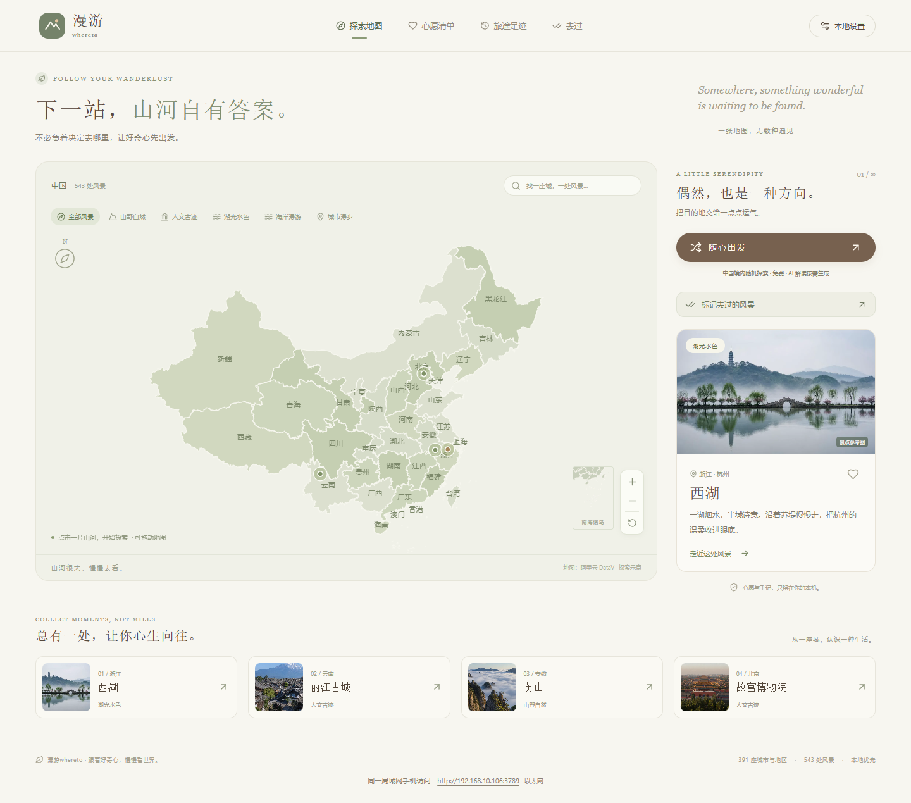
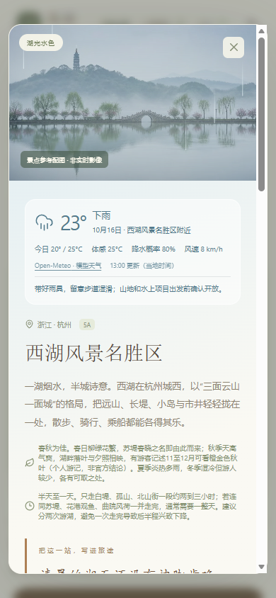
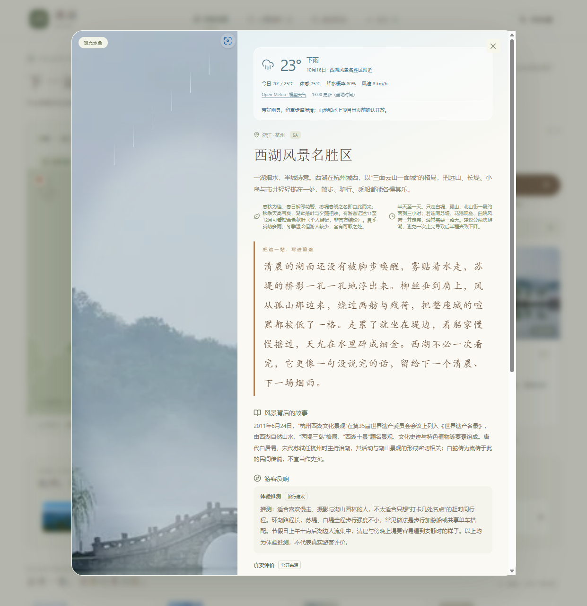

**把好奇心交给地图，遇见下一程。**

391 个城市与地区 · 543 处风景 · DSH Web 驱动 · 本地保存

[功能特色](#功能特色) · [界面预览](#界面预览) · [快速开始](#快速开始) · [文档](docs/README.md)

漫游 whereto 是一个 **DSH Web 旅行探索插件**。从地图出发，发现风景、收藏心愿、记录足迹，再让 DSH Agent 为这一站写下故事与旅行建议。

## 功能特色

| | 让旅行多一点灵感 |
| --- | --- |
| 🗺️ 地图探索 | 省 → 城市 → 景点，支持搜索、分类筛选和随机出发。 |
| ✍️ AI 旅行卡片 | DSH Web 生成散文简介、风景故事、体验推测与出行建议，结果本地缓存。 |
| 🔎 评价有出处 | 检索网页、小红书与知乎，展示能与工具原文核对的评价摘录及链接。 |
| 🌦️ 随天气看风景 | 当地天气、温差与降水信息，搭配随天气变化的卡片氛围。 |
| ❤️ 心愿与足迹 | 收藏想去的地方、标记已经去过的风景，也可粘贴旅行记录批量匹配。 |
| 🧩 复用 DSH 能力 | 沿用宿主模型、预设、工具和 skills；后台服务已启动时直接复用。 |
| 🏡 本地优先 | 基础探索无需模型密钥，记录保存在本机；支持同一局域网手机访问。 |

## 界面预览

<table>
  <tr>
    <td width="75%" align="center">
      
       一张地图，慢慢找到想去的地方
    </td>
    <td width="25%" align="center">
      
       把风景装进口袋
    </td>
  </tr>
</table>

展开查看 DSH 生成的旅行卡片

以上为演示截图，局部样式以当前版本为准。

## 快速开始

先安装含 npm 的 **[Node.js 22+](https://nodejs.org/)**，首次启动需联网。

- **Windows：** 双击 `start.bat`。
- **Linux：** 在项目目录执行 `bash start.sh`。
- **终端：** 在项目目录执行 `npm start`。

页面独立监听 **`0.0.0.0:3101`**，本机地址为 <http://127.0.0.1:3101/>。端口占用时，直接绑定系统分配的空闲端口；启动日志和自动打开的页面使用实际端口。可通过 `WHERETO_PORT` 或插件的 `port` 配置指定首选端口。

同一局域网设备使用 `http://主机局域网IP:实际端口/` 直接访问，无须登录或 token。继续复用 DSH 的模型与凭据；DSH 管理页面保留原有认证，仍可只监听本机。旧的 DSH 子路径保留兼容，日常启动自动打开独立端口。

使用 AI 功能前，在 DSH Web 配好模型与工具。打开一张景点卡片，点击“生成散文简介与解读”即可。

启动脚本要求 **DSH ≥ 0.2.0-rc.2**；缺失或版本过低时自动准备目标版本并重新注册 Web 插件，已满足要求的新版直接复用。

> 详细配置、自定义端口与服务复用，见 [安装与启动](docs/getting-started.md)；遇到问题，见 [排错指南](docs/troubleshooting.md)。

## 文档

[安装与启动](docs/getting-started.md) · [使用指南](docs/user-guide.md) · [排错指南](docs/troubleshooting.md) · [开发说明](docs/development.md)

[架构与存储](docs/architecture.md) · [数据来源与边界](docs/data-sources.md) · [素材与许可](docs/credits.md) · [验证记录](docs/verification.md)

部分景点使用城市参考坐标或 AI 印象配图，卡片均有标注。AI 生成用量由 DSH 与模型服务商计费，浏览缓存不再次调用模型。
